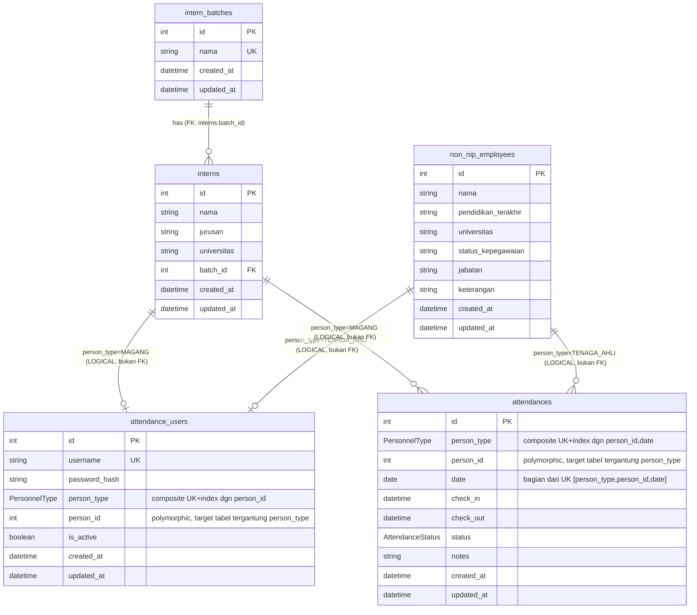

# ERD Modul Absensi — Sistem P3K KKP

## 1. ERD (Mermaid)

Catatan pada diagram: garis dari `interns`/`non_nip_employees` menuju `attendance_users` dan `attendances` **sengaja ditandai "LOGICAL, bukan FK"** karena Mermaid tidak punya notasi native untuk conditional/polymorphic relationship. Garis-garis itu hanya representasi visual dari relasi aplikasi, bukan constraint PostgreSQL yang sesungguhnya. Satu-satunya garis FK sungguhan di diagram ini adalah `interns.batch_id → intern_batches.id`.

## 2. Penjelasan Relasi

**`intern_batches` ↔ `interns`** — Relasi FK asli. Satu `intern_batches` bisa punya banyak `interns` (`interns.batch_id` adalah FK ke `intern_batches.id`, ada index `[batch_id]`). Ini relasi standar one-to-many yang divalidasi PostgreSQL.

**`attendance_users` ↔ personel (`interns` / `non_nip_employees`)** — Bukan FK. `attendance_users` menyimpan `person_type` + `person_id`. Kombinasi ini di-*constraint* dengan `@@unique([person_type, person_id])`, artinya satu personel (baik intern maupun tenaga ahli) hanya boleh punya satu akun `attendance_users`. Tapi PostgreSQL tidak tahu bahwa `person_id` itu valid merujuk ke baris di `interns` atau `non_nip_employees` — validasi itu murni tanggung jawab aplikasi/Prisma layer.

**`attendances` ↔ personel (`interns` / `non_nip_employees`)** — Sama, bukan FK. Setiap baris `attendances` merujuk personel via `person_type` + `person_id`, dan `@@unique([person_type, person_id, date])` memastikan satu personel hanya punya satu record absensi per tanggal.

## 3. Polymorphic Relationship: `person_type` + `person_id`

Ini adalah pola **polymorphic association** (mirip Rails' polymorphic belongs_to atau pola "type discriminator"). Cara kerjanya:

- `person_type` adalah discriminator (enum `MAGANG` atau `TENAGA_AHLI`) yang menentukan *tabel mana* yang harus dirujuk oleh `person_id`.
- Jika `person_type = MAGANG`, maka `person_id` secara logis merujuk ke `interns.id`.
- Jika `person_type = TENAGA_AHLI`, maka `person_id` secara logis merujuk ke `non_nip_employees.id`.
- PostgreSQL **tidak bisa** membuat FK constraint yang kondisional seperti ini (FK Postgres hanya bisa menunjuk ke satu tabel target tetap). Karena itu integritas referensial untuk kolom ini **sepenuhnya bergantung pada logika aplikasi** (misalnya di service/repository layer Prisma), bukan pada database.
- Pola ini dipakai konsisten di dua tabel: `attendance_users` (identitas login) dan `attendances` (record harian), keduanya menggunakan pasangan kolom yang sama sebagai polymorphic key.

## 4. Business Rules yang Tercermin dari Schema

- **Satu personel = satu akun attendance**: `attendance_users.@@unique([person_type, person_id])` mencegah satu intern/tenaga ahli terdaftar dua kali sebagai user absensi.
- **Satu personel = satu record absensi per tanggal**: `attendances.@@unique([person_type, person_id, date])` mencegah double check-in di hari yang sama.
- **Status absensi default `HADIR`**: setiap record baru otomatis dianggap hadir kecuali diubah — ini berarti aplikasi harus proaktif membuat record `IZIN`/`SAKIT`/`ALFA` secara eksplisit, bukan mengandalkan default untuk kasus selain hadir.
- **`check_in` dan `check_out` bersifat opsional** (`DateTime?`): mengakomodasi status non-hadir (`IZIN`, `SAKIT`, `ALFA`) yang tidak memerlukan jam masuk/keluar, sekaligus status `HADIR` yang mungkin baru punya `check_in` tanpa `check_out` (belum pulang).
- **Username unik lintas semua personel**: `attendance_users.username` unik secara global, tidak dipisah per `person_type`, jadi username magang dan tenaga ahli berbagi satu namespace.
- **`is_active` sebagai soft-disable**: memungkinkan menonaktifkan akun tanpa menghapus histori login/absensi.
- **Filtering & reporting cepat**: index `[date]` dan `[status]` pada `attendances` mengindikasikan kebutuhan query umum seperti "absensi hari ini" atau "rekap per status" — konsisten dengan kebutuhan modul absensi harian.
- **Tanggal absensi bertipe `Date`** (bukan `DateTime`) — menegaskan bahwa satu hari kalender = satu slot absensi, terlepas dari jam berapa check-in terjadi (relevan dengan requirement WIB/Asia-Jakarta, meskipun tidak eksplisit di-enforce di level tipe data — lihat catatan desain).

## 5. Catatan Desain / Potensi Masalah

- **Tidak ada integritas referensial untuk polymorphic key.** `person_id` di `attendance_users` maupun `attendances` bisa saja menunjuk ke `id` yang tidak pernah ada di `interns`/`non_nip_employees` (data anak yatim/orphan), karena PostgreSQL tidak memvalidasinya. Ini harus dijaga ketat di application layer (misalnya lewat transaction check atau trigger custom).
- **Tidak ada `ON DELETE` behavior yang jelas untuk relasi polymorphic.** Jika sebuah baris di `interns` atau `non_nip_employees` dihapus, tidak ada mekanisme cascade/restrict otomatis dari PostgreSQL untuk `attendance_users`/`attendances` terkait — berpotensi meninggalkan record absensi "yatim" yang menunjuk personel yang sudah tidak ada.
- **Risiko collision `id` antar tabel target.** Karena `interns.id` dan `non_nip_employees.id` masing-masing auto-increment independen, `person_id = 5` bisa valid di kedua tabel sekaligus dengan makna berbeda. Ini bukan bug, tapi menegaskan bahwa `person_id` **tidak boleh pernah dipakai tanpa `person_type`** di query manapun — kombinasi keduanya wajib selalu bersama.
- **Tidak ada penanganan timezone eksplisit di schema.** Requirement menyebutkan WIB/Asia-Jakarta, tapi field `date`, `check_in`, `check_out` menggunakan tipe Prisma standar (`DateTime`, `@db.Date`) tanpa anotasi timezone-aware (`@db.Timestamptz`) yang terlihat di schema yang diberikan. Konversi ke WIB kemungkinan ditangani di application layer, tapi ini titik rawan bug (mis. absensi "hari ini" salah tanggal karena UTC vs WIB).
- **`notes` di `attendances` tanpa batasan panjang atau struktur** — bisa jadi cukup untuk kasus sederhana, tapi tidak ada validasi format (misalnya wajib diisi saat status `IZIN`/`SAKIT`).
- **Default `status = HADIR`** berisiko menyesatkan jika ada proses yang membuat record absensi di awal hari sebelum personel benar-benar hadir (record akan terbaca "HADIR" padahal orangnya belum datang) — perlu dipastikan alur aplikasi tidak membuat record prematur dengan status default ini.
